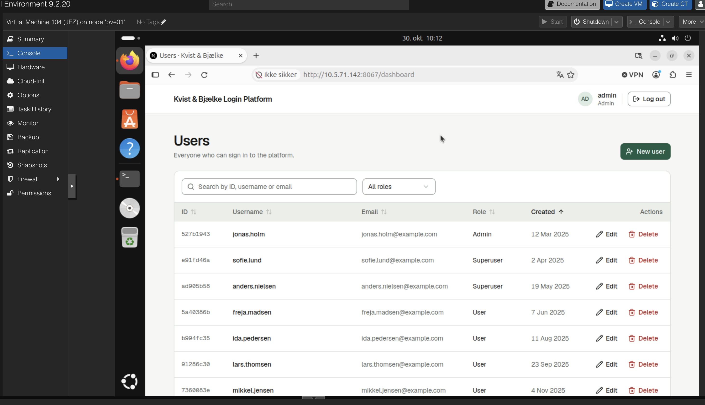
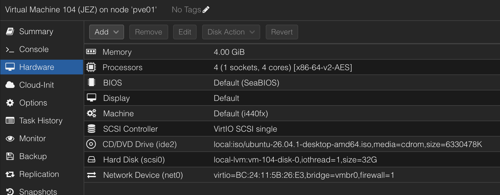
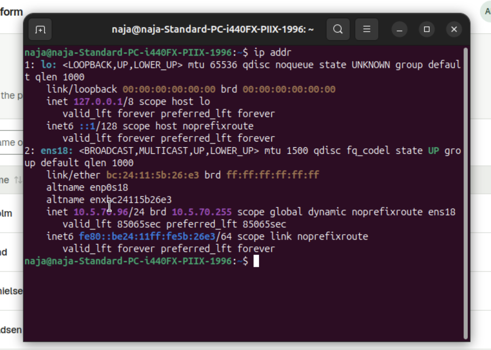
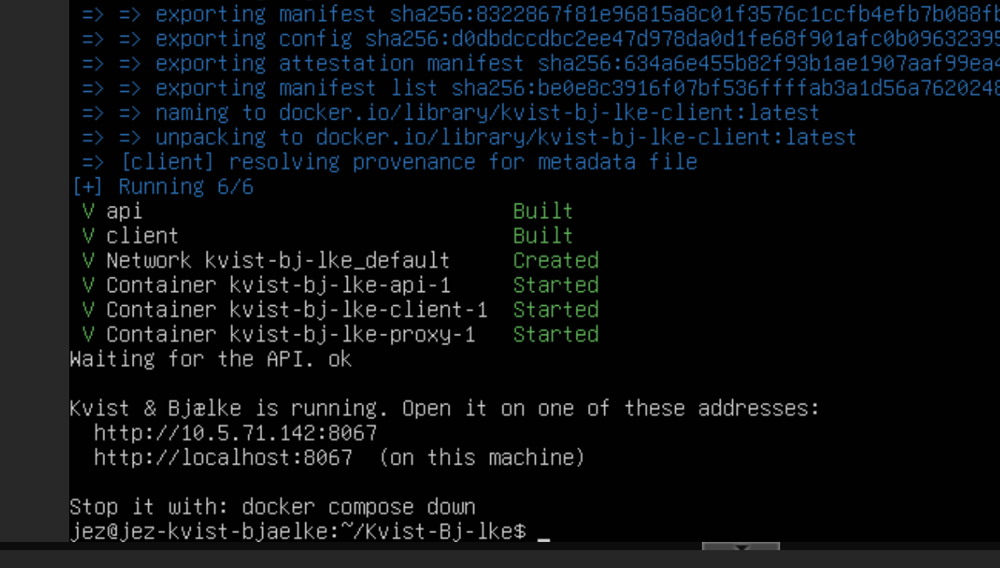
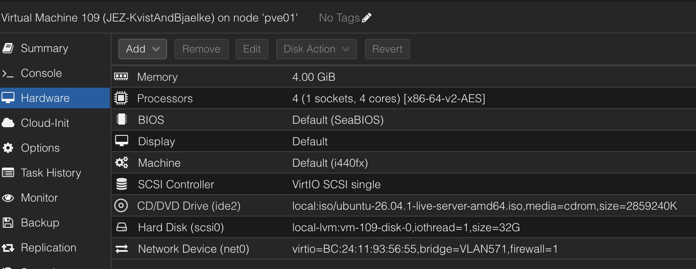
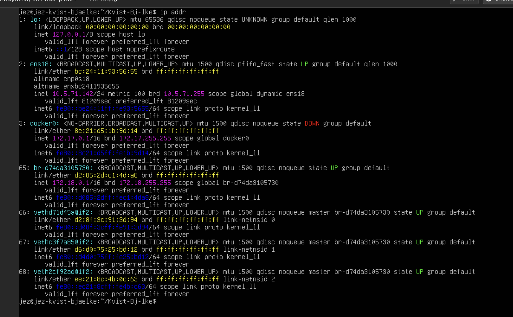

# Kvist & Bjælke Login Platform

A login platform for Kvist & Bjælke ApS. Users log in with a username and password and see a table of user accounts. What they can see and change depends on their role.

- **Client:** Next.js (`client/`)
- **API:** ASP.NET Core with SQLite (`server/`)
- **Tests:** pytest against the API (`tests/`)

## Running it

Requires the .NET 10 SDK and Bun.

```bash
cd server/Api
dotnet run
```

This starts the API (http://localhost:5041) and the client (http://localhost:3000). In development the database is seeded with test accounts, e.g. `admin` / `admin-password`.

Run the tests with `pip install -r tests/requirements.txt` and `pytest tests`.

### With Docker

Requires Docker only.

```bash
cp .env.example .env   # then set JWT_SECRET and ADMIN_PASSWORD
./start.sh
```

`start.sh` builds and starts the containers, then prints the addresses to open, e.g. `http://<server-ip>:8067`. Run it again after changing code or `.env`.

Everything goes through one port (8067, set with `PORT` in `.env`). A small Caddy proxy sends `/api/...` to the API and everything else to the client, so the browser only talks to one address and works from any IP or hostname without CORS settings. The API and client aren't reachable from the network on their own. The proxy passes on each visitor's IP, so the login rate limit still applies per visitor.

Log in with `admin` and the `ADMIN_PASSWORD` from `.env`. Set `SEED_SAMPLE_USERS=true` to add the sample users.

The database is kept in the `api-data` volume. `docker compose down` stops the app; `docker compose down -v` also deletes the database.

## Roles

| Role | Sees | Can create, edit and delete |
|---|---|---|
| User | Users | Nothing |
| Superuser | Users | Users |
| Admin | Everyone | Everyone |

There is no open registration. Accounts are created by an Admin or a Superuser.

## Authentication method

After a successful login the API returns a **JWT** (JSON Web Token), signed with HMAC-SHA256 and valid for 8 hours. The client sends it in the `Authorization: Bearer` header on every request.

- The API checks the token's signature and expiry on every request.
- The role is always read from the database, not from the token. Role changes and deleted accounts take effect immediately.
- Logging out revokes the token on the server, so it can't be reused.

We chose JWT because the client and API are separate applications. A bearer token works across them without server-side sessions, and since it isn't a cookie, it isn't exposed to CSRF.

## How passwords are handled and stored

- Passwords are **never stored in plain text**. They are hashed with ASP.NET Core Identity's `PasswordHasher`: PBKDF2 with HMAC-SHA512, 100,000 iterations and a random salt per password. Only the hash is stored.
- Hashes are **never sent to the client**. API responses have no password or hash field.
- Passwords must be **at least 12 characters**, checked on the server.
- When editing a user, the password is optional. Leaving it blank keeps the existing hash.

## Other security decisions

- **Permissions are checked on the server** for every request. Hiding buttons in the UI is only for convenience, and direct API requests get the same checks. Accounts a user isn't allowed to see return 404, so their existence isn't revealed.
- **Brute-force protection:** a username is locked for 15 minutes after 5 failed logins, and each IP address is limited to 10 login attempts per minute.
- **Failed logins don't reveal whether a username exists.** The message is the same, and the server runs a password check against a dummy hash for unknown usernames, so both cases take the same time.
- **All input is validated on the server:** username format, email, role and password length.
- **SQL injection** is prevented by parameterised queries (linq2db), and React escapes all output against XSS.

## Network

The company's network is split into VLANs to improve security and performance. Employee desktops and laptops are in their own VLAN, separate from the servers. This limits the impact of a compromised device and leaves room for more employees. Keeping all servers in a separate VLAN makes it possible to protect critical systems. Visitors get their own guest network, so they can't reach company resources.

| VLAN | Name | Network (CIDR) | Subnet mask | Default gateway | Usable hosts | Devices | Assigned by |
|---|---|---|---|---|---|---|---|
| 570 | Clients | 10.5.70.0/24 | 255.255.255.0 | 10.5.70.1 | 254 | 15 desktops, 10 laptops (wired and Wi-Fi) | DHCP |
| 571 | Servers | 10.5.71.0/24 | 255.255.255.0 | 10.5.71.1 | 254 | 3 servers (incl. login platform VM) | Static |
| 572 | Printers | 10.5.72.0/27 | 255.255.255.224 | 10.5.72.1 | 30 | 3 network printers | Static |
| 573 | VoIP | 10.5.73.0/26 | 255.255.255.192 | 10.5.73.1 | 62 | 12 IP phones | DHCP |
| 574 | Cameras | 10.5.74.0/27 | 255.255.255.224 | 10.5.74.1 | 30 | 6 cameras | Static |
| 575 | Guest | 10.5.75.0/24 | 255.255.255.0 | 10.5.75.1 | 254 | Guest phones and laptops | DHCP |
| 576 | Management | 10.5.76.0/27 | 255.255.255.224 | 10.5.76.1 | 30 | Switches, router, APs | Static |

The login platform runs on a VM in the server VLAN (571). Employees in the client VLAN (570) open it on port 8067 (see [With Docker](#with-docker)).

### Subnetting

**VLAN 571 – Servers**

- Network address: 10.5.71.0/24
- Subnet mask: 255.255.255.0
- Available hosts: 254
- Gateway: 10.5.71.1

This subnet is used for the 3 servers currently in operation, but more virtual machines and services may be deployed later. With 254 usable hosts there is plenty of room for expansion.

**VLAN 570 – Clients**

- Network address: 10.5.70.0/24
- Subnet mask: 255.255.255.0
- Available hosts: 254
- Gateway: 10.5.70.1

Employee desktops and laptops use this subnet. The company only has 25 devices, but the network provides 254 usable host addresses. This allows the company to add more employees and devices in the future without redesigning the network.

### Client (VLAN 570)

An employee desktop: an Ubuntu Desktop VM (VM 104) in Proxmox. It gets the address `10.5.70.96` from DHCP in the client VLAN, and opens the login platform on the server at `http://10.5.71.142:8067`.

The login platform opened from the client:



The client VM's hardware in Proxmox:



The client's IP address, `10.5.70.96/24`:



### Server (VLAN 571)

The login platform server: an Ubuntu Server VM (VM 109) in Proxmox, connected to the `VLAN571` bridge with the address `10.5.71.142`. It runs the platform with Docker (see [With Docker](#with-docker)).

The platform started with `./start.sh`:



The server VM's hardware in Proxmox, with its network device on the `VLAN571` bridge:



The server's IP address, `10.5.71.142/24`. The `docker0`, `br-…` and `veth…` interfaces are Docker's internal networks:



## Screenshots

Login:


Admin sees every account and can manage all of them:


Superuser only sees and manages accounts with the User role:


