# Kvist & Bjælke Login Platform

A web-based login platform for Kvist & Bjælke ApS. Staff log in with a username and password and see a table of user accounts. What they can see and change depends on their role: **User**, **Superuser** or **Admin**.

This README covers how to run the project, how it is built, and the security decisions behind it, with screenshots of the main features.

- [Running it locally](#running-it-locally)
- [How it is built](#how-it-is-built)
- [Roles and permissions](#roles-and-permissions)
- [Security decisions](#security-decisions)
- [Screenshots](#screenshots)
- [Configuration for production](#configuration-for-production)
- [Tests](#tests)

## Running it locally

You need the [.NET 10 SDK](https://dotnet.microsoft.com/download) and [Bun](https://bun.sh).

```bash
cd server/Api
dotnet run
```

This one command starts the API on http://localhost:5041 and the web client on http://localhost:3000, and opens the browser. Stopping it (Ctrl+C) stops both. The first build installs the client's packages with `bun install`. The SQLite database (`server/Api/kvist-bjaelke.db`) is created on first start.

In development the database is seeded with sample accounts. These passwords exist only in `appsettings.Development.json` and are not used anywhere else:

| Username | Password | Role |
|---|---|---|
| `admin` | `admin-password` | Admin |
| `jonas.holm` | `user-password` | Admin |
| `sofie.lund`, `anders.nielsen` | `user-password` | Superuser |
| `freja.madsen`, `ida.pedersen` and 8 more | `user-password` | User |

To start over with fresh sample data, stop the app and delete `server/Api/kvist-bjaelke.db`.

## How it is built

| Part | Technology | Folder |
|---|---|---|
| Web client | Next.js 16, React 19, Tailwind CSS 4, shadcn/ui | `client/` |
| API | ASP.NET Core (.NET 10), controllers, NSwag (OpenAPI) | `server/Api/` |
| Business rules | Services for users and login, permission checks, validation | `server/Service/` |
| Data access | linq2db on SQLite | `server/Infra/` |
| Tests | pytest against the running API | `tests/` |

The client never talks to the database. It calls the API over HTTP using a TypeScript client generated from the API's OpenAPI description with `swagger-typescript-api` (`client/lib/generated/api.ts`). After changing an endpoint, run `bun run generate-api` in `client/` while the API is running.

### API endpoints

| Method and path | Who can call it | What it does |
|---|---|---|
| `POST /Login` | Anyone | Checks username and password, returns a token |
| `POST /Logout` | Logged in | Revokes the caller's token |
| `GET /GetMe` | Logged in | Returns the caller's own account |
| `GET /GetUsers` | Logged in | Lists the accounts the caller may see |
| `POST /CreateUser` | Admin, Superuser | Creates an account |
| `PUT /UpdateUser?userId=…` | Admin, Superuser | Changes username, email, role and optionally the password |
| `DELETE /DeleteUser?userId=…` | Admin, Superuser | Deletes an account |

There is deliberately no registration endpoint. Accounts can only be created by an Admin or a Superuser.

## Roles and permissions

| | Sees | Create | Edit | Delete |
|---|---|---|---|---|
| **User** | Accounts with the User role | – | – | – |
| **Superuser** | Accounts with the User role | Users | Users | Users |
| **Admin** | Every account | Any role | Any role | Any role |

On top of the table:

- An account you are not allowed to see is treated as if it does not exist. Editing or deleting it returns **404 Not Found**, not 403, so the response does not reveal that the account exists. A Superuser can't see their own account, because it isn't a User account.
- A Superuser can't give anyone the Superuser or Admin role, whether creating or editing.
- Nobody can delete their own account.
- The last Admin can't be changed to another role, so the platform always has at least one Admin.

## Security decisions

### Authentication method

Users log in with a username and password. On success the API returns a signed **JSON Web Token (JWT)**:

- Signed with HMAC-SHA256 using a server secret of at least 32 characters. The API refuses to start without one.
- Valid for 8 hours. Issuer, audience, lifetime and signature are checked on every request.
- Contains the user's ID (`sub`), a unique token ID (`jti`), the username and the role.

The client keeps the token in the browser's `localStorage` and sends it in the `Authorization: Bearer …` header. It is not stored in a cookie, so the API is not exposed to cross-site request forgery (CSRF): another website can't make the browser attach the token automatically.

The role in the token is **not trusted** for permission decisions. On every request the API loads the caller's account from the database and uses its current role. If an Admin changes someone's role, it takes effect on that person's next request. If their account is deleted, their token stops working straight away.

We chose JWT over server-side sessions because the API and the client run as separate applications, possibly on different hosts. A bearer token works across origins without cookie configuration, and the server needs no session storage. The downside, that a token stays valid until it expires, is handled by [logout revoking the token](#logout).

### How passwords are handled and stored

- **Never stored in plain text.** Passwords are hashed with ASP.NET Core Identity's `PasswordHasher`, using **PBKDF2 with HMAC-SHA512, 100,000 iterations, a random 16-byte salt per password and a 32-byte derived key**. Only the hash is stored, in the `PasswordHash` column. The salt and the settings are stored inside the hash, so they can be raised later. Old hashes are upgraded automatically the next time that user logs in.
- **Never sent to the client.** API responses use a separate type (`UserResponseDto`) that has no password or hash field. The tests check that no response contains them.
- **At least 12 characters**, checked on the server on create and on edit. The limit is 128 characters, so a request can't make the server hash an enormous input.
- **Required when creating a user.** When editing, the password field is optional. Leaving it blank keeps the existing hash untouched.
- **Never logged or shown again.** The password field in the edit form always starts empty.

PBKDF2 was chosen because it is the built-in, well-reviewed hasher in ASP.NET Core and is designed to be slow, which makes guessing passwords from a stolen database expensive. Comparisons go through the hasher's own constant-time check.

### Protection against brute-force attacks

Two independent limits:

1. **Per account.** After 5 failed logins for a username within 15 minutes, that username is locked for the rest of the 15 minutes. Usernames that don't exist are counted the same way, so a lockout never reveals whether an account exists. A successful login resets the count.
2. **Per IP address.** At most 10 login attempts per minute from one IP address, whatever the usernames. Further attempts get **429 Too Many Requests**.

### Failed logins don't reveal whether an account exists

- **Same message.** A wrong password and an unknown username both get the same response: *"That username and password don't match."*
- **Same timing.** When the username doesn't exist, the server still runs a full password check against a dummy hash, so both cases take the same time. Measured locally: about 36 ms for a wrong password on a real account and 37 ms for an unknown username.

### Logout

Logging out calls `POST /Logout`, which puts the token's ID on a deny list until the token would have expired. The API refuses that token from then on, even if someone copied it. The client then deletes its copy.

### Permissions are enforced on the server

Every permission rule lives in `server/Service/UserService.cs`, and every endpoint goes through it. Hiding buttons in the client is only a convenience. A request sent directly to the API, for example with curl, gets the same checks:

- The permission check runs **before** input validation, so a forbidden request is refused whatever it contains.
- When editing, the role is checked against both the account's current role and the new one, so a Superuser can't promote a User to Admin.
- Requests without a valid token get **401**, forbidden actions **403**, and accounts the caller can't see **404**.

### Input validation

All input is validated on the server (`server/Service/UserValidation.cs`). The client shows the same rules in its forms only to help people.

| Field | Rule |
|---|---|
| Username | 3–32 characters: letters, numbers, dots, dashes and underscores. Stored in lowercase. Must be unique. |
| Email | A valid address with no display name, at most 254 characters. Stored in lowercase. Must be unique. |
| Role | Exactly `User`, `SuperUser` or `Admin`. |
| Password | 12–128 characters. |

Malformed or missing request bodies are rejected with 400. Errors are returned as standard `ProblemDetails` JSON, and unexpected errors are logged on the server but only return a generic message, so internal details never reach the client.

### Other measures

- **SQL injection:** all database access goes through linq2db, which sends parameterised queries. No SQL is built from user input.
- **Cross-site scripting (XSS):** React escapes everything it renders, and the client never inserts raw HTML. Usernames are also limited to safe characters.
- **CORS:** only the client's own address (`http://localhost:3000` by default) may call the API from a browser.
- **Security headers** on every API response: `X-Content-Type-Options: nosniff`, `X-Frame-Options: DENY` and `Referrer-Policy: no-referrer`.
- **API description:** Swagger is only served in development.
- **Secrets:** the JWT secret and the first Admin's password are not in the repository's production settings. The API refuses to start if they are missing.

### Known limitations

- **In-memory state:** the login lockouts and the logout deny list are kept in memory. Restarting the API clears them, so a logged-out token would work again until it expires (at most 8 hours). Running several API instances would need a shared store such as Redis.
- **Token storage:** the token is kept in `localStorage`, which a successful XSS attack could read. React's escaping makes this unlikely, but an `HttpOnly` cookie would remove the risk at the cost of CSRF protection.
- **HTTPS:** the API does not redirect to HTTPS itself. In production it must run behind a proxy or host that handles TLS, so passwords and tokens are never sent unencrypted.
- **Uniqueness:** when a Superuser picks a username or email that belongs to an account they can't see, they get "already taken". This reveals that the account exists, but usernames and emails have to stay unique.

## Screenshots

**Login page.** There is no sign-up link: accounts are created by an administrator.

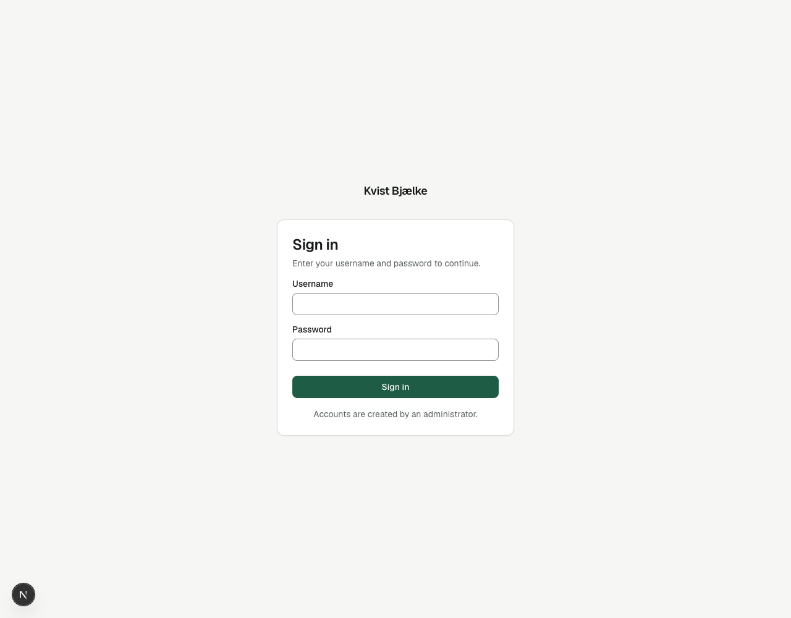

**A failed login gives the same message whether or not the username exists.**

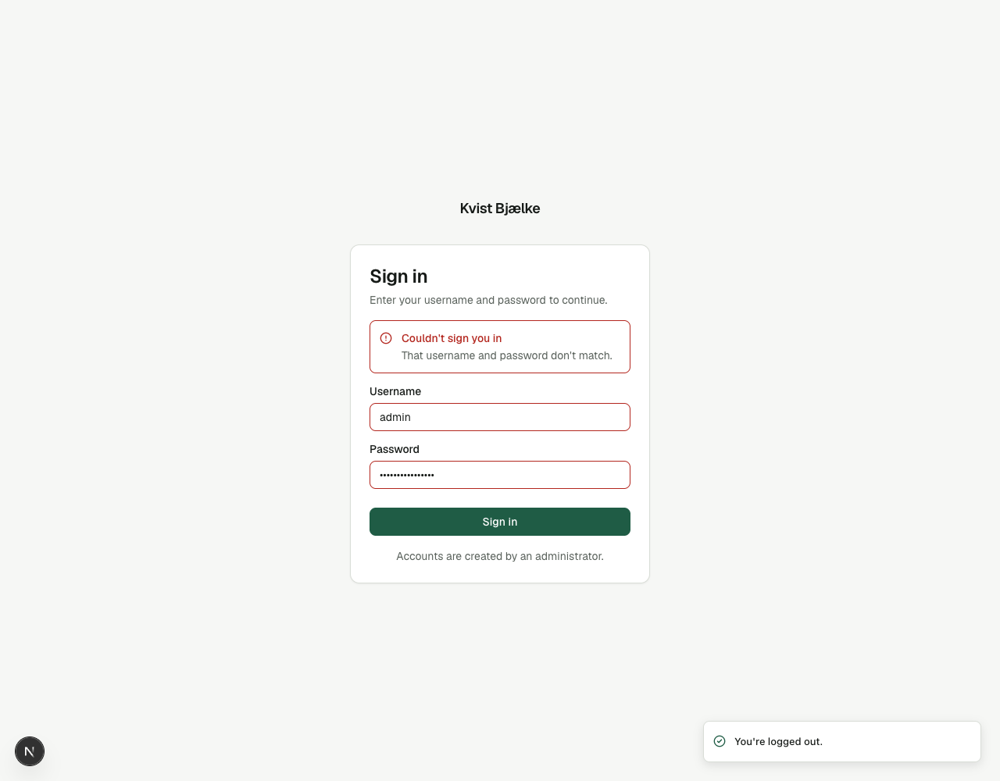

**After 5 failed attempts the username is locked for 15 minutes.** Here the username doesn't even exist, and it is locked the same way.

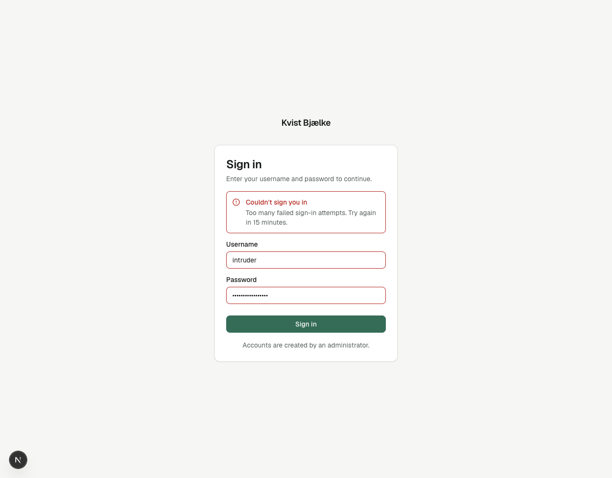

**Admin** sees every account and has New user, Edit and Delete for all of them.

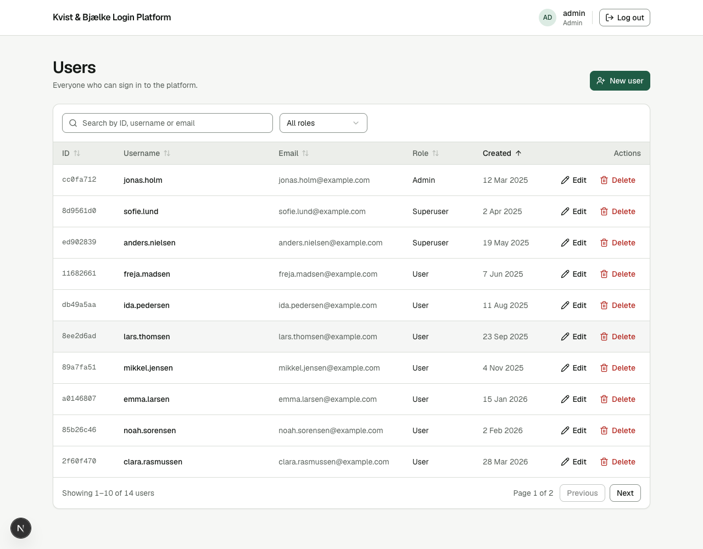

**Superuser** only sees accounts with the User role, and can manage them.

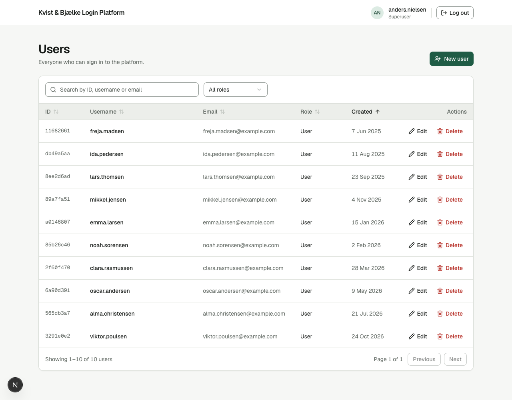

The role filter only offers the roles the logged-in user can see.

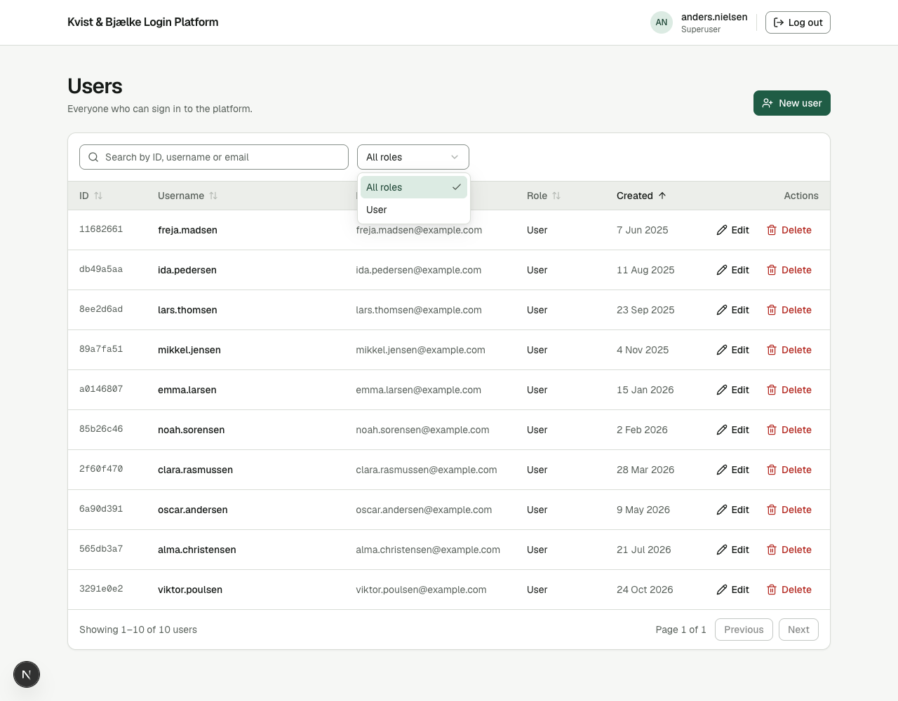

**User** sees the same accounts, read-only: no New user, Edit or Delete.

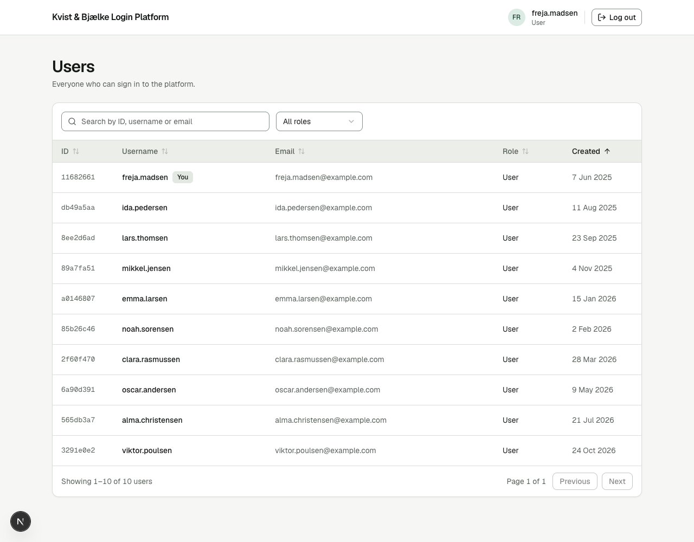

**Editing** a user. The password is optional, and leaving it blank keeps the current one.

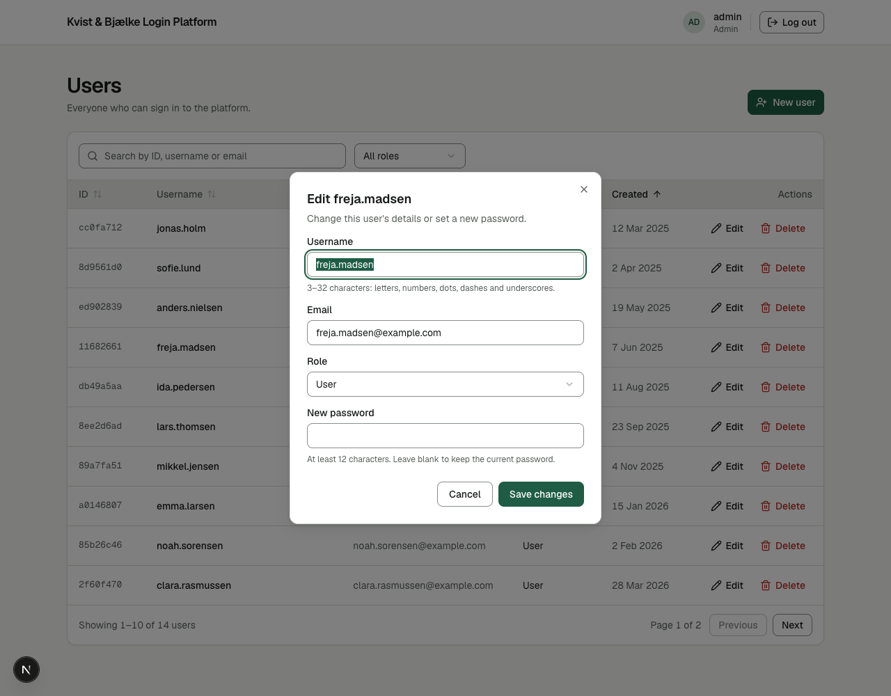

**Success messages** confirm what happened after each action.

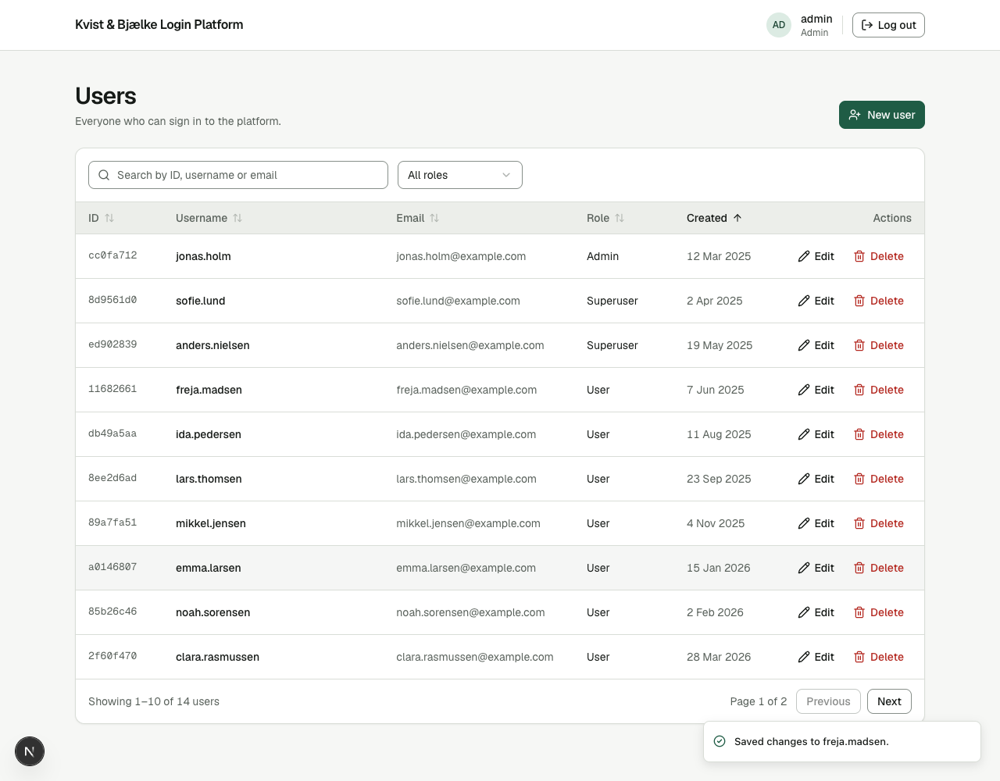

**Errors from the server** are shown in the form. Here the username is already taken.

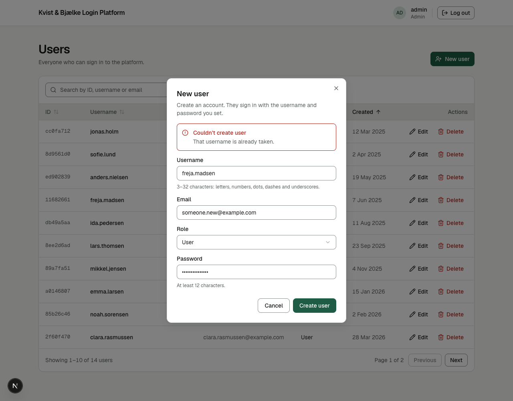

**Deleting asks for confirmation first.**

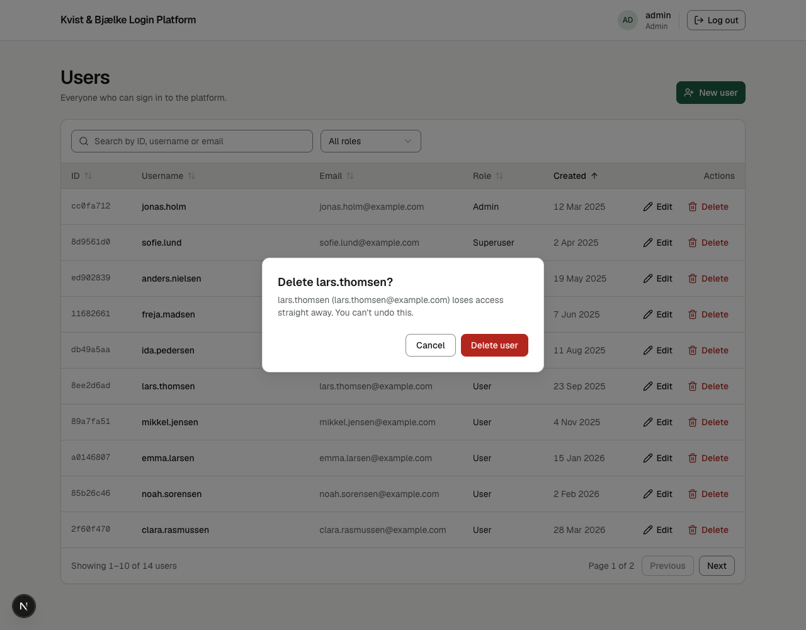

## Configuration for production

Set these as environment variables on the API (ASP.NET Core reads `__` as a section separator):

| Variable | Purpose |
|---|---|
| `ASPNETCORE_ENVIRONMENT` | `Production`. This turns off Swagger and the sample accounts. |
| `Jwt__Secret` | Signing key for tokens, at least 32 random characters. Required. |
| `Admin__Password` | Password for the first Admin account, at least 12 characters. Required. |
| `Admin__Username`, `Admin__Email` | The first Admin's username and email (defaults: `admin`, `admin@example.com`). |
| `ConnectionStrings__Default` | SQLite connection string, e.g. `Data Source=/data/kvist-bjaelke.db`. |
| `Cors__Origins__0` | The web client's public address, e.g. `https://login.example.com`. |
| `RateLimit__LoginPerMinute` | Login attempts per IP address per minute (default 10). |

The first Admin is only created when the database has no Admin yet. Changing `Admin__Password` later does not change an existing account's password.

Build and start the client with `NEXT_PUBLIC_API_URL` set to the API's public address:

```bash
cd client
NEXT_PUBLIC_API_URL=https://api.example.com bun run build
bun run start
```

## Tests

The tests in `tests/` start the real API against a throwaway database and send HTTP requests to it, as each role. They check that every role only sees the accounts it should (in the list, search, the role filter, counts and paging), that hidden accounts return 404, and the create, edit and delete rules.

```bash
pip install -r tests/requirements.txt
pytest tests
```
